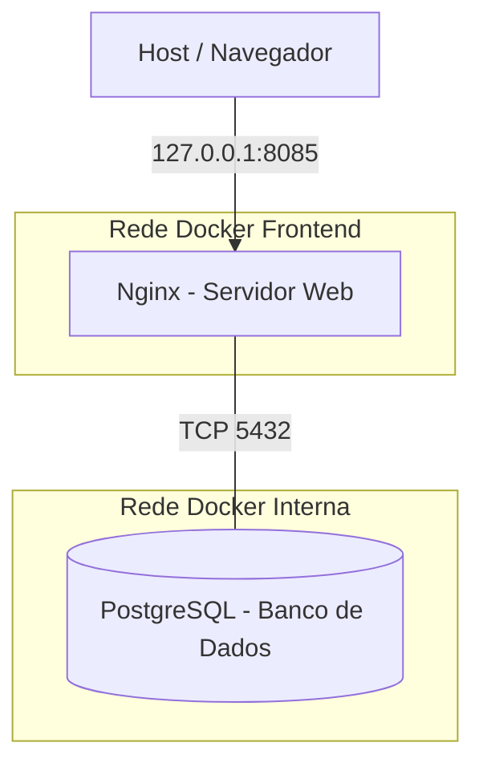

# Infrastructure as Code & GitOps — Security Lab

Projeto acadêmico desenvolvido para a disciplina de
Infrastructure as Code (GitOps), do curso Superior de
Tecnologia em Segurança Cibernética da FIAP.

**Autor:** Pedro de Carvalho Gonçalves  
**RM:** 561506  
**Instituição:** FIAP  
**Ambiente:** Ubuntu 22.04 LTS / WSL2

## Objetivo

Provisionar infraestrutura com Terraform e Docker,
identificar vulnerabilidades de segurança, documentar
um Code Review e aplicar correções preservando
o histórico de alterações no Git.

## Tecnologias

- Terraform — Infrastructure as Code
- Docker — Contêineres e redes
- Nginx — Servidor web
- PostgreSQL — Banco de dados
- Git — Versionamento e rastreabilidade
- Ubuntu 22.04 — Ambiente de laboratório

## Arquitetura corrigida



O PostgreSQL não possui porta publicada no host.
A comunicação com o banco ocorre pela rede
Docker interna `fiap-dp-internal`.

## Fase 1 — Infraestrutura insegura

Foi criada uma configuração Terraform contendo:

- Contêiner Nginx.
- Contêiner PostgreSQL.
- Senha de laboratório definida diretamente no main.tf.
- Porta PostgreSQL publicada em 0.0.0.0:5433.

Commit: `27bb4a2`

Essa configuração foi criada intencionalmente
para análise de vulnerabilidades.

## Fase 2 — Code Review

Foram identificados dois problemas principais:

**1. Credencial em texto puro**

A senha do PostgreSQL estava presente no código
versionado, permitindo sua exposição no histórico Git.

**2. Exposição de porta**

O banco estava publicado em todas as interfaces
do host, ampliando sua superfície de ataque.

Os achados e recomendações estão documentados
em `REVISAO_SEGURANCA.md`.

## Fase 3 — Correção GitOps

As correções implementadas foram:

- Variável Terraform sensível para a senha.
- Arquivo terraform.tfvars ignorado pelo Git.
- Remoção da publicação da porta PostgreSQL.
- Criação de uma rede Docker interna.
- Separação das redes frontend e interna.
- Aplicação das alterações com terraform apply.

Commit: `64c6213`

O histórico da versão insegura foi preservado
para permitir auditoria e comparação.

## Fase 4 — Validação

| Teste | Resultado |
|---|---|
| terraform validate | Aprovado |
| terraform plan após correção | Sem alterações pendentes |
| Histórico Git | Dois commits de infraestrutura preservados |
| terraform.tfvars ignorado | Confirmado |
| Porta PostgreSQL no host | Não publicada |
| Tentativa TCP na porta 5433 do host | Conexão não estabelecida |
| Acesso PostgreSQL pela rede web | SELECT 1 executado |
| Acesso HTTP ao Nginx | HTTP 200 OK |

O teste interno utilizou um cliente PostgreSQL
temporário compartilhando o namespace de rede
do contêiner web.

## Como reproduzir

Pré-requisitos:

- Docker Engine em execução
- Terraform instalado
- Git instalado

Inicialize o projeto:

```bash
terraform init
terraform validate
```

Crie localmente o arquivo `terraform.tfvars`:

```hcl
db_password = "DEFINA_UMA_SENHA_DE_LABORATORIO"
```

Em seguida:

```bash
terraform plan
terraform apply
```

Para verificar:

```bash
docker ps --filter "name=fiap-dp"
docker port fiap-dp-postgres
curl -I http://localhost:8085
```

Para encerrar o laboratório:

```bash
terraform destroy
```

## Histórico de segurança

A versão inicial insegura permanece disponível
no histórico Git exclusivamente para fins didáticos.

Não reutilize a credencial de laboratório em
outros ambientes.

O atributo `sensitive` do Terraform oculta
informações em determinadas saídas, mas não
elimina valores sensíveis do estado Terraform.

## Conclusão

O laboratório demonstrou a importância da revisão
de código de infraestrutura, do controle de segredos,
do isolamento de redes e da rastreabilidade das
alterações realizadas com Git.

A infraestrutura corrigida foi provisionada
e validada por meio de testes reais de conectividade.

---

Projeto acadêmico — FIAP — 2026
